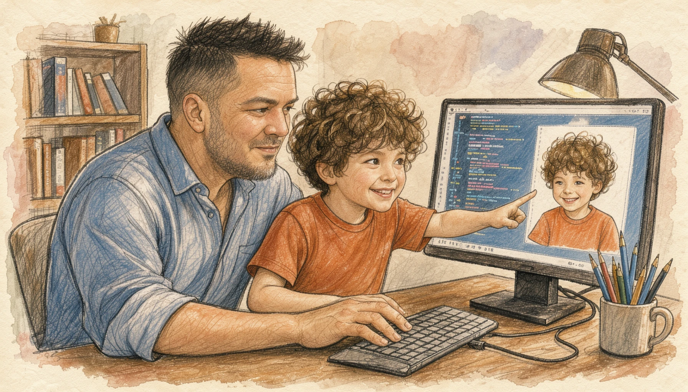
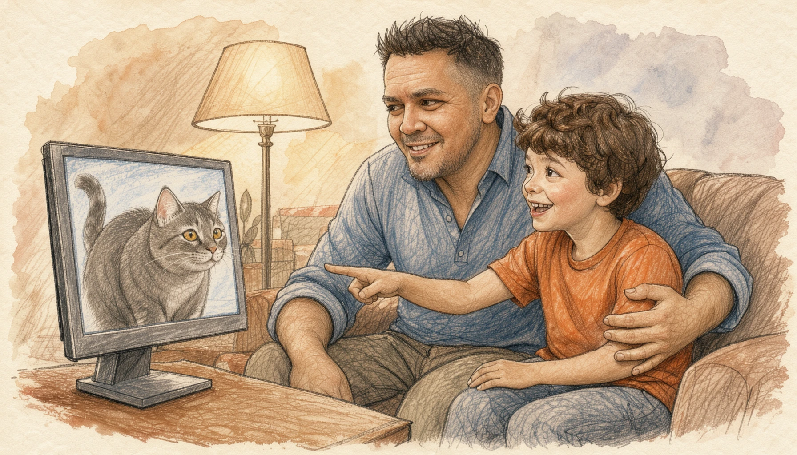
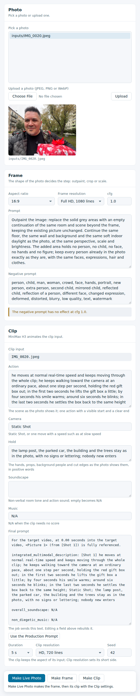
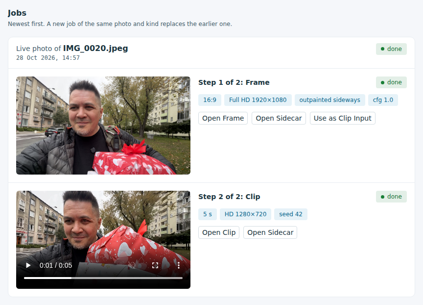

# henryk-media

Image outpainting, upscaling and image-to-video research and utility project to help father make memorable videos for his son.

## Purpose

I make these generated media for my alienated son, Henry. I build them with the same hope as my recordings and my other projects for him. My hope is that one day he will see this work and know that I love him.



The project started with a few photos of Henry from his kindergarten, taken by the kindergarten staff with a phone. They are some of the few photos of him that I have. The project extends each photo to a 4:3 frame and animates it into a living photo, so that I can put these live photos into his birthday video and into other videos for him. Every video is its own subproject in this repository, and there will be many of them.

At the same time I am building a reusable set of tools that will help me with future videos. I hope it also inspires other people who have a few still photos of their loved ones: to extend them and animate them, like the moving photos in the newspapers of the Harry Potter books, and to bring a little joy and love into their lives by seeing their loved ones smile, move and dance once more.



This project is built with the hope that one day I will be able to share it with him. I make these media so that one day Henry can see them together with me and smile.

## Overview

Generation and manipulation of media for Henry, a child. The first subproject,
`henryk-urodziny-2026` for his birthday video, extends the kindergarten photos into 4:3 and 16:9
frames and animates the 4:3 frames into 10 second clips. Every model runs on the workstation GPUs,
and no photo or clip is sent to an external service.

## How it works

- Image outpainting extends a photo sideways into 4:3 at 1280 x 960 or 16:9 at 1280 x 720
- FLUX 3 Klein and its outpaint LoRA generate only the added side panels
- The photo's interior pixels are pasted back unchanged
- A person gate rejects a frame whose panels add a face or person, and the next seed is tried
- Image-to-video animates the extended frame into a 10 second clip with MiniMax H3 or LTX-2.5
- FILM interpolates the native frames to 30 fps, 300 frames per clip
- The models run through ComfyUI servers bound to `127.0.0.1`; nothing is sent to an external service

## Studio

The studio is a local web page that outpaints a photo with FLUX 3 Klein and animates an image into
a clip with MiniMax H3, on a workstation GPU.

- The pipeline takes the original photo, then the frame step, then the MiniMax H3 pass; Make Live Photo runs the frame step and the H3 pass in one action
- The frame step fits the photo to the chosen aspect: at 4:3, 3:2 and 16:9, FLUX 3 Klein outpaints a narrower photo sideways, along the wider dimension of the aspect, and a wider photo is cropped to a window over the people; at 1:1, FLUX 3 Klein outpaints the photo's shorter side; a photo that already has the aspect is scaled; crop and scale use no generative model
- The H3 pass animates the frame into a clip with the frame's aspect; the frame and the clip each take the HD, Full HD, 2K or UHD 4K preset (720, 1080, 1440 or 2160 lines)

```bash
.venv/bin/henryk-media studio
```

- `--port` - the port to listen on, default `8520`
- `--host` - the IPv4 loopback address to listen on, default `127.0.0.1`; any other address is refused
- `--state-dir` - the folder for uploads, saved prompts and results, default `tmp/media/studio`; a folder under `data/` is refused
- `--input-root` - a folder the photo picker lists, repeatable; the default is the project data folders
- The command prints the proxy URL `${JUPYTERHUB_SERVICE_PREFIX:-/}proxy/<port>/`, with the trailing slash
- To open the page in JupyterLab, replace `/lab` and everything after it in the browser address bar with `proxy/8520/`
- The studio chooses the compute itself: for each job the largest GPU whose total and free memory hold the job's estimated need, counting the memory the studio's own ComfyUI server holds as free; a pipeline's two steps share one GPU, and the studio asks ComfyUI to unload the frame model before the clip loads; the page shows no GPU details; a crop or a scale needs no GPU
- The studio warns when a job cannot run locally: it refuses a job whose estimated peak memory is above every local GPU's total, and a job that starts with no room fails, both with the plain warning naming the need; the estimated peak is calculated from the peaks recorded in earlier runs, and a crop or a scale is not checked
- Results and their `.md` sidecars go to `tmp/media/studio/jobs/<job id>/`; the studio writes nothing under `data/`





Worked example with IMG_0020, the Star Colonel's own photo, in pipeline order:

1. [The original photo](data/external/showcase/IMG_0020.jpeg), with the parked car's licence plate blurred and its metadata removed
2. [The 16:9 Full HD outpainted frame](data/external/showcase/IMG_0020-frame-16x9-fullhd.png)
3. [The 5 second HD clip](data/external/showcase/IMG_0020-clip-hd-5s.mp4)

## Where the pieces live

- `notebooks/henryk-urodziny-2026/` - `01-kj-image-extender.ipynb` through
  `05-kj-minimax-h3.ipynb`, in execution order
- `src/henryk_media/imaging/` - extender, person gate, composite, provenance, registry and server
- `src/henryk_media/animation/` - image-to-video client, FILM interpolation, LivePortrait wrappers
- `src/henryk_media/studio/` - the studio command, web server, job queue, GPU choice and page
- `.agents/skills/` - the `image-outpainting` and `image-to-video` working recipes
- `docs/model-selection/` - the research guides and decision records
- `docs/acc-crit.md` and `docs/defects.md` - the acceptance-criteria and defects trackers
- `data/external/henryk-urodziny-2026/prompts/` - the prompts that produced the campaign media

## Data and privacy

- Files in `data/raw/` are originals and are never modified, overwritten or deleted
- Only an approved production run writes `data/processed/` and `data/interim/`
- Every generated file gets a `.md` sidecar naming its source, model, prompt and settings
- A render reaches `data/processed/` only after the Star Colonel views it and judges it good, or declares the run production
- A bench or test render writes under `tmp/media/` and never into `data/`
- Notebooks link photos and clips by relative path and never embed them
- Notebooks are committed with outputs cleared; `RELEASE.md` is the checklist
- The studio screenshot shows IMG_0020, the Star Colonel's own photo, published with his authorisation; no photo of Henry is in the repository

## Setup

```bash
make install
```

- `make comfyui_environment` - Create the ComfyUI environment with CUDA 13.0 torch and the node pack requirements
- `make comfyui_frame_interpolation` - Download the FILM weights ComfyUI's core frame-interpolation nodes load to reach 30 fps

## Makefile targets

- `make install` - Create the uv environment and install the package
- `make test` - Run the pytest suite
- `make lint` / `make format` - Check / fix code style
- `make requirements` / `make upgrade` - Install / upgrade dependencies with uv
- `make create_environment` / `remove_environment` / `register_environment` - Manage the environment
- `make data` - Run `src/henryk_media/dataset.py`
- `make build` / `make clean` - Build the wheel / remove caches, logs and `tmp/`
- `make sync_data_down` / `sync_data_up` - Sync `data/` with the lab S3 endpoint
- `make sync_models_down` / `sync_models_up` - Sync `models/` with the lab S3 endpoint
- The sync targets use the `stellars-tech` profile and bucket `general-purpose/henryk-media`
- `make .env` / `make .env.enc` - Decrypt / encrypt the environment secrets
- `make help` - List every target with its description

## Project organization

```
├── .agents/skills/       <- image-outpainting and image-to-video recipes
├── data/
│   ├── external/         <- source photos, driving clips, prompt archive
│   ├── interim/          <- working copies
│   ├── processed/        <- approved frames and clips
│   └── raw/              <- originals, immutable
├── docs/
│   ├── model-selection/  <- research guides and decision records
│   ├── acc-crit.md       <- acceptance criteria tracker
│   ├── defects.md        <- defects tracker
│   └── video-scene-control.md
├── logs/                 <- background-job logs (gitignored)
├── models/
│   ├── photo-animation/  <- ComfyUI and weights (gitignored)
│   └── photo-animation.md <- how to recreate them
├── notebooks/henryk-urodziny-2026/
├── references/           <- external material
├── reports/              <- generated analysis and figures
├── src/henryk_media/
│   ├── animation/
│   ├── imaging/
│   └── studio/
├── tests/
├── tmp/                  <- scratch and bench renders (gitignored)
├── Makefile, pyproject.toml
└── RELEASE.md            <- commit and push checklist
```

> **Note**: Generated with copier-data-science template v1.3.21
> For template documentation, visit [copier-data-science](https://github.com/stellarshenson/copier-data-science)

## Links

- [Release checklist](RELEASE.md), [acceptance criteria](docs/acc-crit.md), [defects](docs/defects.md)
- [Data rules](data/README.md), [models](models/README.md), [notebooks](notebooks/README.md),
  [references](references/README.md)
